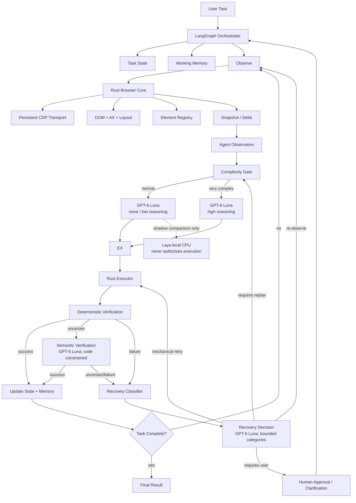
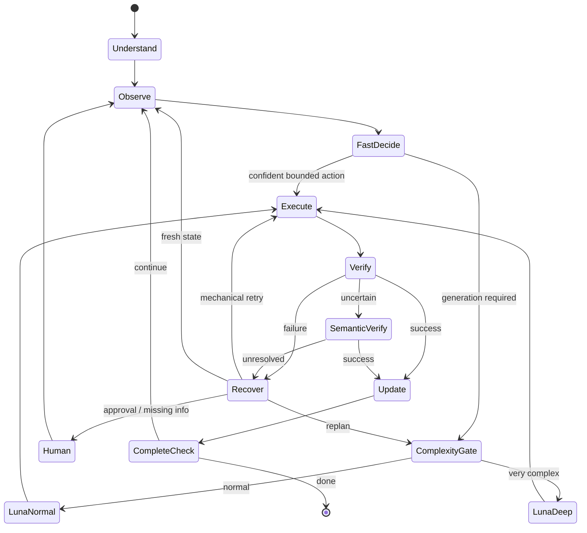

# BROWSKI Architecture Plan

**Status:** This is the architecture authority for the BROWSKI implementation
in this repository (`mango`). The separate `Agent-Browser-Benchmark` checkout
contains historical screenshot and extension benchmark experiments. Production
code and the active architecture plan belong here.
M0–M7 foundations exist. M8–M11 productization is implemented within the
documented capability limits and is ready for local review; M12 large-scale
task-success benchmarking remains deferred. The managed browser path is
available, and managed-mode on-demand vision is wired behind explicit visual
need. The Native Messaging relay, attached Rust transport, and extension task
dispatch are implemented, with real packaged-browser software acceptance passed.
An opt-in isolated semantic-data transform, optional provider privacy modes,
encrypted checkpoints, local metrics, settings and Linux source installation
are implemented. Screenshot redaction and live-provider task acceptance remain
unverified or unavailable. Do not describe fixture-backed software tests as
proof of autonomous task reliability.

**Current runtime policy (supersedes older System One routing below):**
GPT-6 Luna is the only active decision provider permitted to produce
executable actions. Laya is shadow-only and is not trusted for execution. Jev
is disabled and is not required. Do not call Jev or tune Laya during the
productization phase. Bound Luna actions to runtime-generated semantic
candidates, then require deterministic verification in Rust.

Laya-only benchmark evaluation has been performed and did not establish trust
for execution. Jev has not been called. Live OpenAI inference remains
unverified.

**Primary objective:** Build a reliable, open-source, provider-aware browser
agent that can complete long-running browser tasks with low latency and low
cost while retaining deterministic browser grounding, execution, and
verification.

---

## 1. Product North Star

The agent should eventually feel like:

```text
install
→ provide API keys
→ give a browser task
→ agent completes it
→ every important decision/action is traceable
```

Examples:

- Search and compare information across many pages.
- Fill long forms from user-provided context.
- Navigate multi-tab workflows.
- Extract structured information from dynamic web applications.
- Handle SPA navigation, iframes, dialogs, popups, downloads, and uploads.
- Recover from stale elements, rerenders, failed interactions, and wrong intermediate states.
- Pause for user approval when an action is consequential.

The primary metric is:

> **End-to-end task success rate.**

Latency, token use, model cost, action count, recovery rate, and reliability are optimization metrics around that north star.

---

# 2. Core Architectural Idea

The browser agent uses **two decision speeds**.

### Bounded decision contracts (shadow/evaluation only in current runtime)

The `DecisionProvider` interface supports local Laya and optional TypeSafe
Jev contracts for bounded judgments. The current runtime does not route
executable decisions through either provider: Laya is shadow-only and Jev is
disabled. Laya's confidence values are not trusted as execution thresholds.

Examples:

- Which valid action should happen next?
- Did the previous action materially progress the task?
- Is this state ambiguous?
- Should we continue locally or escalate?
- Which recovery class best describes the current failure?
- Is the current subgoal complete?

Bounded decision providers do **not** own browser execution or generate
arbitrary plans. Their contract remains useful for shadow comparison and
future independently validated policy.

### System Two — Generative planning

Use **OpenAI GPT-6 Luna only** for tasks requiring generative reasoning.

There is no Sol/Astra model route in the baseline architecture.

GPT-6 Luna operates in two modes:

```text
NORMAL GENERATIVE MODE
GPT-6 Luna
reasoning.effort = none or low

VERY COMPLEX MODE
GPT-6 Luna
reasoning.effort = high
```

High reasoning is enabled **only when the task state is classified as genuinely complex**. `xhigh` is deferred and is not part of the baseline effort surface.

The complexity gate is code-controlled and benchmarked.

The active routing policy is:

```text
bounded immediate action
      ↓
GPT-6 Luna (none/low, through ComplexityGate)
      ↓
validate against supplied semantic candidates
      ↓
Rust execution + deterministic verification

optional shadow comparison
      ↓
Laya (local CPU; cannot authorize or change action)


very complex state
      ↓
Complexity Gate
      ↓
GPT-6 Luna (high)
      ↓
validate output and policy in code
      ↓
   execute
```

---

# 3. Full Architecture



---

# 4. Language Ownership

The project remains intentionally polyglot.

## Rust

Rust owns browser infrastructure and performance-sensitive state.

```text
Rust
├── persistent CDP transport
├── browser/session lifecycle
├── tab/frame lifecycle
├── browser events
├── DOM/AX/layout collection
├── semantic observation
├── ElementRegistry
├── snapshot diffing
├── typed browser executor
├── deterministic verification
├── low-level recovery
└── runtime telemetry
```

Rust must never depend on LLM/provider behavior.

---

## Python

Python owns agent intelligence and experimentation.

```text
Python
├── LangGraph orchestration
├── TaskState
├── WorkingMemory
├── Decision-provider integration (Laya + Jev)
├── OpenAI integration
├── ComplexityGate
├── planner
├── high-level recovery
├── checkpointing
├── provider policy
├── benchmarking
└── agent telemetry
```

Python depends on the stable Rust interface through PyO3/maturin.

---

## TypeScript

TypeScript is reserved for browser-facing/product tooling.

```text
TypeScript
├── trace viewer
├── developer UI
├── optional browser extension
└── optional JavaScript SDK
```

Use Bun where it improves TypeScript development/runtime ergonomics.

Do not move core browser runtime logic into TypeScript simply because a frontend exists.

---

## Go

Go is not part of the baseline architecture.

It may be introduced only if a future isolated service demonstrates a measurable reason:

- significantly simpler deployment,
- higher-throughput service handling,
- operational isolation,
- or lower engineering complexity.

No language is added for architectural novelty.

---

# 5. Current Foundation

The M0–M2 completion status below is preserved from the prior BROWSKI runtime
work. The current checkout does not contain the Rust workspace or its runtime
implementation, so those milestones cannot be independently inspected here.
The status is retained as project history; the README describes the code
available in this checkout.

## Milestone 0 — Scaffold

**Complete**

Established:

- Rust workspace.
- Python package.
- PyO3/maturin bridge.
- browser launch/navigation/observation vertical slice.
- tests.
- CI.
- architecture documentation.
- ADR discipline.
- shared contracts.

---

## Milestone 1 — Persistent Browser Runtime

**Complete**

Implemented:

- one persistent browser-level CDP connection.
- reader/writer ownership.
- command ID correlation.
- pending command map.
- typed CDP events.
- timeout cleanup.
- deterministic disconnect fan-out.
- tab lifecycle.
- frame lifecycle.
- reconnect.
- browser process lifecycle.
- browser event subscriptions.
- explicit runtime errors.
- extensive stress testing.

Important invariant:

> Only the CDP transport owns the WebSocket.

---

## Milestone 2 — Observation + Element Identity

**Complete**

Implemented:

```text
CDP DOM + Accessibility + Layout
             ↓
      frame/shadow walk
             ↓
 visibility/interactability
             ↓
      semantic labeling
             ↓
       ElementRegistry
             ↓
      SemanticSnapshot
             ↓
        SnapshotDelta
             ↓
      AgentObservation
```

Capabilities include:

- stable `ElementRef`.
- deterministic semantic aliases.
- ambiguity refusal.
- generation-based staleness.
- multi-signal fingerprints.
- label resolution.
- DOM + accessibility enrichment.
- iframe provenance.
- open shadow DOM.
- visibility classification.
- interactability classification.
- hit testing.
- agent-facing pruning.
- snapshot diffing.
- page fingerprinting.
- deterministic rendering.

Important invariant:

> The model never produces a selector.

It refers to semantic targets supplied by the runtime.

---

# 6. Milestone 3 — Executor + Verification

**Implemented in Mango.** The contract below records the M3 architecture; the
implementation repository is Mango, not this documentation/benchmark checkout.

M3 turns structured intent into a browser state transition and proves whether the intended effect occurred.

## Core contract

```text
BrowserAction
      ↓
validate target generation
      ↓
resolve ElementRef
      ↓
precondition checks
      ↓
capture pre-state
      ↓
execute trusted browser input
      ↓
bounded settling
      ↓
capture post-state
      ↓
deterministic verification
      ↓
ActionOutcome
```

## BrowserAction

Initial actions:

```text
Navigate
Click
Type
Select
Check
Hover
Press
Scroll
Back
Forward
Reload
ActivateTab
CloseTab
NewTab
HandleDialog
```

Later:

```text
UploadFile
Download
Drag
RichTextEdit
BrowserCodeEscapeHatch
```

File upload is deferred until the browser runtime has an explicit, bounded file
input contract and verification coverage.

## ActionOutcome

Conceptually:

```text
ActionOutcome
├── action
├── execution_status
├── verification_status
├── before_generation
├── after_generation
├── state_delta
├── evidence
├── elapsed_ms
└── failure
```

Verification is tri-state:

```text
SUCCESS
FAILURE
UNCERTAIN
```

Important invariant:

> A successful browser command is not automatically a successful agent action.

---

# 7. Milestone 4 — Dual-Speed Agent Runtime

**Core implemented in Mango.** The design below records the architecture
boundary; production runtime sources live in Mango.

Use **LangGraph** only for orchestration.

LangGraph does not own:

- CDP,
- element identity,
- screenshots,
- browser execution,
- verification mechanics,
- browser-level retries.

It owns durable workflow state.

## Proposed graph



---

# 8. Decision-Provider Contracts (shadow and evaluation only)

The `DecisionProvider` contract remains available for bounded decisions and
evaluation. Current runtime policy allows only Laya shadow comparison; Jev is
disabled, and neither provider can select an executable action.

```text
DecisionProvider
├── LayaProvider   # local CPU; shadow only
└── JevProvider    # optional contract; disabled
```

Both providers must expose the same internal capabilities:

- bounded Choice-style decisions
- Score-style judgments
- yes/no probability / Noul-style judgments
- semantic verification
- recovery classification
- progress checks

Do not assume Laya and Jev produce identical confidence values. Each provider keeps its own calibration/thresholds (see §36); code policy interprets normalized outcomes, never raw provider scores directly.

A decision provider should be treated as a **decision primitive**, not a general-purpose agent.

## Responsibilities

### A. Next-action routing

The runtime constructs only valid action candidates.

Example:

```text
Task:
Apply Bengaluru filter and search.

State:
@location textbox value=""
@remote checkbox false
@search button

Candidates:
A: type "Bengaluru" into @location
B: toggle @remote
C: click @search
D: scroll
E: escalate_to_planner
```

GPT-6 Luna chooses among the runtime-generated candidates. A returned action
must match a candidate and bind to the current semantic observation. Laya may
receive a separate comparison request after Luna selects; its response is
never used to execute or authorize an action.

Code retains authority over whether the action is permitted.

---

### B. Escalation decision

Question:

```text
Can this state be handled using the bounded action set,
or does it require generative planning?
```

Possible route:

```text
FAST_ACTION
LUNA_PLAN
USER_INPUT
```

---

### C. Progress judgment

GPT-6 Luna may judge whether a browser transition meaningfully advanced the current subgoal after deterministic delta checks. Laya's result is shadow telemetry only.

This complements deterministic state-delta checks.

---

### D. Semantic verification

Deterministic verification always runs first.

Use GPT-6 Luna only when browser evidence remains semantically ambiguous after deterministic verification.

Example:

```text
Expected:
user should have advanced to shipping step

Observed:
URL unchanged
form changed substantially
heading became "Shipping details"
previous controls disappeared
```

GPT-6 Luna can judge whether this constitutes semantic progress; its response does not override code-enforced completion requirements.

---

### E. Recovery classification

Candidate recovery classes:

```text
TRANSIENT_UI
STALE_STATE
WRONG_TARGET
WRONG_ACTION
INSUFFICIENT_INFORMATION
NEEDS_REOBSERVE
NEEDS_REPLAN
NEEDS_VISION
ASK_USER
```

GPT-6 Luna selects from bounded recovery categories. Laya may compare in shadow but does not route recovery.

---

### F. Task/subgoal completion

Use a narrow completion judgment only after deterministic completion checks.

The agent must never be able to declare benchmark/task success solely because a model emitted `DONE`.

---

# 9. Decision-Provider Policy Boundary

Keep this separation explicit:

```text
STATE
  ↓
GPT-6 LUNA JUDGMENT
  ↓
CODE POLICY
  ↓
ACTION
```

Neither Laya nor Jev authorizes:

- irreversible purchases,
- sending messages,
- submitting forms with consequences,
- deleting data,
- account/security modifications,
- financial actions,
- external publication.

Those require deterministic policy and, when configured, user confirmation.

---

# 10. GPT-6 Luna Integration

Use only:

```text
model = gpt-6-luna
```

through the OpenAI Responses API.

No Sol/Astra route is part of the standard architecture.

## Luna Normal Mode

Use for:

- generating a short local plan,
- interpreting unfamiliar page structure,
- resolving non-bounded ambiguity,
- choosing a recovery strategy,
- understanding a user instruction that cannot be reduced to a finite decision immediately.

Default:

```text
reasoning.effort = none
```

or:

```text
reasoning.effort = low
```

The exact default must be benchmarked.

---

## Luna Deep Mode

Use only when the **ComplexityGate** marks a situation `VERY_COMPLEX`.

Potential triggers:

- repeated recovery failures.
- multi-page task with conflicting intermediate evidence.
- nested dependency planning.
- ambiguous goal requiring decomposition.
- significant state mismatch after multiple attempts.
- unfamiliar workflow where no bounded candidate set is safe.
- long-horizon task where the current plan is no longer consistent with observed state.
- complex visual interpretation requiring screenshot reasoning.
- cross-tab information synthesis.
- task constraints conflict and require explicit reconciliation.

Then use:

```text
reasoning.effort = high
```

The baseline does not route to `xhigh`. A future change may consider it only if benchmark evidence justifies expanding the effort surface:

```text
reasoning.effort = xhigh
```

Do not use high reasoning because a page is merely large.

Do not use high reasoning because one action failed.

Do not use high reasoning by default.

---

# 11. ComplexityGate

The gate itself should initially be deterministic.

Example inputs:

```text
recovery_count
replan_count
uncertainty_count
number_of_active_subgoals
number_of_tabs
dependency_depth
ambiguous_target_count
verification_uncertainty
plan_state_mismatch
vision_required
task_horizon_estimate
```

Conceptual policy:

```python
if repeated_recovery >= threshold:
    VERY_COMPLEX

elif plan_state_mismatch and task_horizon_high:
    VERY_COMPLEX

elif requires_cross_tab_synthesis and ambiguity_high:
    VERY_COMPLEX

else:
    NORMAL
```

The decision providers do not assist the ComplexityGate. **Hard caps and
escalation policy stay in code.**

The gate must be benchmarked against:

```text
task success
latency
OpenAI token use
reasoning-token use
cost
number of escalations
unnecessary escalations
recovery success
```

---

# 12. Agent State

LangGraph should use a compact typed state.

Conceptually:

```python
class AgentState:
    task: Task
    task_status: TaskStatus

    current_snapshot: SemanticSnapshotSummary
    latest_delta: SnapshotDeltaSummary

    current_plan: Plan | None
    current_subgoal: Subgoal | None

    working_memory: WorkingMemory

    last_action: BrowserAction | None
    last_outcome: ActionOutcome | None

    retries: RetryBudget
    recovery_count: int
    replan_count: int

    complexity: ComplexityLevel

    pending_confirmation: ConfirmationRequest | None

    trace_id: str
```

Do not place entire DOM/snapshot history into LangGraph state.

The Rust runtime owns detailed browser state.

---

# 13. Working Memory

Long-running tasks need explicit bounded memory.

```text
WorkingMemory
├── user goal
├── constraints
├── completed milestones
├── current subgoal
├── acquired facts
├── relevant entities
├── failed strategies
├── irreversible actions already performed
├── pending questions
└── next intended milestone
```

Do not continually append raw transcripts.

Use:

```text
recent_steps
+
structured memory
+
checkpoint summary
```

Old observations should be discarded unless they contain information required for the task.

---

# 14. Planning Strategy

Do not generate an entire long-horizon browser plan upfront.

Use hierarchical planning:

```text
USER GOAL
   ↓
short milestone plan
   ↓
current subgoal
   ↓
next browser action
```

Example:

```text
Goal:
Apply to suitable internships.

Milestones:
1. Find candidate listings.
2. Filter based on constraints.
3. Inspect selected roles.
4. Prepare application.
5. Ask user before submission.

Current subgoal:
Set location filter to Bengaluru.

Next action:
type @location "Bengaluru"
```

Replan when state invalidates the current milestone plan.

---

# 15. Observation Policy

The browser-native semantic observation remains primary.

```text
DOM
+
Accessibility
+
Layout
+
Browser state
+
Snapshot delta
    ↓
SemanticSnapshot
    ↓
AgentObservation
```

Default agent context should contain:

- current task/subgoal.
- current URL/title.
- relevant semantic elements.
- changed elements.
- alerts/dialogs.
- relevant nearby text.
- tab summary.
- recent verified action.
- compact working memory.

---

# 16. Vision Policy

Vision is complementary.

Do not screenshot every step by default.

Request a screenshot when:

```text
canvas content matters
SVG meaning cannot be reconstructed
chart/image interpretation is required
DOM/AX disagree
custom widget has insufficient semantics
visual layout carries important meaning
unlabelled icons create ambiguity
verification is visually ambiguous
```

For those cases GPT-6 Luna can receive the screenshot through multimodal input.

Local visual models remain optional future modules.

---

# 17. Executor Policy

Model output never directly touches CDP.

```text
Model/decision-provider Decision
      ↓
Python validates decision
      ↓
BrowserAction
      ↓
Rust validates target/state
      ↓
Rust Executor
      ↓
CDP
```

Every target action uses `ElementRef`.

No model-generated CSS/XPath selectors.

No arbitrary JavaScript in the normal path.

---

# 18. Verification Stack

Use a three-level verification stack.

## Level 1 — Deterministic Rust verification

Examples:

```text
input value changed
checkbox changed
selected option changed
URL changed
target disappeared
expected element appeared
new tab opened
dialog appeared
document/frame changed
```

This is the default.

---

## Level 2 — Luna semantic verification

Use when deterministic signals do not conclusively establish semantic success. Laya remains shadow-only and cannot establish success.

---

## Level 3 — Higher-effort GPT-6 Luna

Use only if the ComplexityGate promotes the genuinely complex case.

Deep reasoning is still gated separately.

---

# 19. Recovery Architecture

Recovery must remain explicit.

```text
Failure
   ↓
classify
   ↓
mechanical repair?
   ├─ yes → Rust recovery
   └─ no
       ↓
     decision-provider route
       ↓
 reobserve / retry / replan / vision / ask user
```

## Rust-level recovery

Only deterministic mechanics:

- reacquire element.
- scroll into view.
- wait bounded time for transient overlay.
- re-hit-test.
- handle detached node.
- handle navigation race.
- refresh target generation.

It does not invent a new strategy.

---

## Agent-level recovery

Python owns:

- alternate action.
- alternate path through workflow.
- subgoal revision.
- plan revision.
- model escalation.
- user clarification.

---

# 20. Stagnation Detection

Long-running reliability requires explicit stagnation detection.

Signals:

```text
same action repeated
same state fingerprint repeated
A → B → A → B oscillation
no meaningful state delta
no subgoal progress
repeated verifier uncertainty
repeated target reacquisition
repeated navigation to same location
recovery budget consumed without progress
```

Response ladder:

```text
1. reobserve
2. retry mechanically
3. alternate action
4. decision-provider recovery classification
5. Luna normal replan
6. Luna deep reasoning if ComplexityGate triggers
7. ask user
8. terminate with explicit failure
```

No infinite loops.

---

# 21. Human-in-the-Loop

LangGraph interruption/checkpoint semantics should support approval.

Examples:

```text
submit application
send email/message
purchase
delete
publish
modify account security
financial action
irreversible external side effect
```

The graph pauses with:

```text
what will happen
why
important values
target
expected effect
```

Then continues from the checkpoint after approval.

---

# 22. Persistence

Use SQLite initially.

Persist:

```text
runs
graph checkpoints
task state
working memory
actions
action outcomes
verification evidence
model calls
decision-provider decisions (with provider id + per-provider calibration version)
complexity decisions
recoveries
cost/latency metrics
artifacts
```

Large raw snapshots/screenshots should be referenced as artifacts rather than embedded repeatedly in state rows.

---

# 23. Telemetry

The runtime also supports opt-in local debug sessions: sanitized task prompts,
provider requests and public responses, runtime events, browser summaries, and
bounded-candidate validation diagnostics. Capture is separate from graph
checkpoints, bounded by session size and retention, and ignored by Git.
Credentials, screenshot bytes, and hidden reasoning are excluded. This does
not change provider routing or action authorization. See
[`docs/user/debugging.md`](docs/user/debugging.md).

The following is the target per-step trace contract. The foundation currently
has partial task-state and provider telemetry, but does not yet emit this full
structured record for every graph step.

```text
StepTrace
├── step_id
├── task_id
├── snapshot_generation
├── observation_size
├── route
│   ├── deterministic
│   ├── decision_laya
│   ├── decision_jev
│   ├── luna_normal
│   └── luna_deep
├── decision_latency
├── model_tokens
├── reasoning_effort
├── action
├── execution_latency
├── verification
├── recovery
├── state_delta
├── cost
└── progress
```

This lets us explain not just whether the agent succeeded, but **why it was fast or slow**.

---

# 24. Benchmark Strategy

The architecture must be justified by ablation testing. These comparisons are
an evaluation plan, not completed cross-provider or end-to-end results.

## Baseline A — Luna-only

```text
GPT-6 Luna
→ action
→ executor
→ verifier
```

## Baseline B — Luna with Laya shadow telemetry (evaluation only)

```text
GPT-6 Luna selects
→ optional Laya shadow comparison
→ only Luna's bounded action reaches the executor
```

## Baseline C — Deferred Laya shadow comparison

```text
GPT-6 Luna active decisions
→ Laya shadow observation only
→ no shadow output reaches executor
```

The final architecture wins only if it measurably improves the combined objective.

Track:

```text
task success rate
partial completion
wall-clock duration
steps
browser action failures
verification failures
recovery success
stagnation
Luna calls and reasoning effort
Laya shadow calls, agreement, and latency
Luna calls
deep-reasoning calls
input tokens
output tokens
reasoning tokens
total model cost
decision p50/p95/p99
browser p50/p95/p99
```

---

# 25. Benchmark Targets

Integrate progressively:

```text
synthetic deterministic corpus
BrowserGym
WebArena / WebArena-Verified
VisualWebArena
WorkArena
AssistantBench
BU Bench
Mind2Web-related evaluation
custom long-horizon browser tasks
```

Do not integrate every benchmark before the core agent works.

---

# 26. Model-Routing Success Criteria

The dual-speed architecture should demonstrate:

```text
same or higher task success
+
fewer GPT-6 Luna calls
+
fewer high-reasoning calls
+
lower median decision latency
+
lower cost
+
equal or better recovery success
```

If the decision provider does not improve those metrics on representative tasks, reduce or remove its responsibilities.

Architecture choices remain empirical.

---

# 27. Safety and Action Risk

Classify actions before execution.

```text
LOW
navigation
search
scroll
read/extract

MEDIUM
form fill
upload
changing application state

HIGH
submit
send
purchase
delete
publish
security/account modification
financial action
```

Policy remains deterministic.

Models may estimate semantics, but they do not override confirmation rules.

---

# 28. Provider Boundaries

Use explicit interfaces.

```text
DecisionProvider
├── decide_bounded(...)      # Choice-style bounded decisions
├── score(...)               # Score-style judgments
├── judge_binary(...)        # yes/no probability / Noul-style judgments
├── check_progress(...)      # progress / subgoal completion checks
├── classify_recovery(...)   # recovery classification
└── semantic_verify(...)     # semantic verification

ReasoningProvider
├── plan(...)
├── replan(...)
└── interpret_visual_state(...)
```

Concrete baseline:

```text
LunaDecisionAgent = active path
LayaProvider = shadow only (optional)
JevProvider = disabled
ReasoningProvider = OpenAILunaProvider
```

Provider contracts remain configurable for isolated tests and future evaluation;
the product runtime must not select Jev/adaptive routing or use Laya confidence
to authorize actions. Do not compare raw confidence scores across providers.

Do not import vendor SDKs throughout the agent.

They remain behind adapters.

---

# 29. LangGraph Boundary

LangGraph is the **durable state machine**, not the browser agent implementation itself.

Allowed:

```text
workflow nodes
conditional edges
checkpointing
interrupt/resume
state transitions
human approval
recovery routing
```

Not allowed:

```text
browser selectors
DOM parsing
CDP handling
element resolution
click mechanics
verification mechanics
browser lifecycle
```

The graph can be replaced later without rewriting browser infrastructure.

---

# 30. Proposed Python Structure

```text
python/src/browser_agent/
├── agent/
│   ├── graph.py
│   ├── nodes.py
│   ├── state.py
│   └── runtime.py
│
├── decisions/
│   ├── base.py          # DecisionProvider interface
    │   ├── laya.py          # LayaProvider (optional shadow only)
    │   ├── jev.py           # JevProvider (disabled in current runtime)
│   ├── candidates.py
│   ├── calibration.py   # provider-specific thresholds
│   └── policy.py
│
├── reasoning/
│   ├── base.py
│   ├── openai_luna.py
│   ├── complexity.py
│   ├── planning.py
│   └── prompts.py
│
├── memory/
│   ├── working.py
│   ├── compaction.py
│   └── checkpoints.py
│
├── recovery/
│   ├── classifier.py
│   ├── policy.py
│   └── stagnation.py
│
├── verification/
│   └── semantic.py
│
├── policy/
│   ├── risk.py
│   └── confirmation.py
│
├── persistence/
├── telemetry/
└── cli/
```

---

# 31. Rust Structure

```text
crates/
├── cdp/
├── browser-core/
├── observation/
├── element-registry/
├── executor/
├── verification/
├── recovery/
├── telemetry/
└── python-bindings/
```

Do not move reasoning into these crates.

---

# 32. End-to-End Example

Task:

```text
Find an AI internship in Bengaluru,
open a suitable role,
fill the application using my profile,
but don't submit it.
```

Flow:

```text
1. LangGraph initializes task.

2. Rust observe():
   @search textbox
   @location textbox
   @search_button button

3. GPT-6 Luna chooses the bounded action:
   type the task-approved value into @location.

4. Rust execute + verify.
   SUCCESS.

5. Reobserve delta.

6. GPT-6 Luna chooses click @search_button from the bounded candidate set.

7. Execute + verify.
   SUCCESS.

8. Results page contains many semantically similar listings.

9. Bounded choice is insufficient.
   Escalate to GPT-6 Luna, reasoning=none/low.

10. Luna makes a short subgoal plan:
    inspect likely AI roles and compare constraints.

11. Decision provider handles routine open/back/next decisions.

12. A listing has ambiguous compensation information.

13. Luna interprets relevant content.

14. Application form opened.

15. Decision provider handles deterministic field sequence.

16. Rust verifies each fill.

17. Dynamic form rerenders and invalidates one ref.

18. Rust reacquires or returns structured failure.

19. Decision-provider recovery classifier routes REOBSERVE.

20. Agent continues.

21. Submit button reached.

22. Risk policy marks submission HIGH/consequential.

23. User instruction explicitly says "don't submit".

24. Agent stops with application filled and reports completion.
```

No deep reasoning was needed.

---

# 33. Very-Complex Example

Task:

```text
Compare suitable plans across multiple websites,
respect several constraints,
derive which combination is cheapest,
and complete the setup flow without committing payment.
```

The agent:

```text
GPT-6 Luna handles active decisions with none/low effort
        ↓
Luna normal handles local planning
        ↓
multiple tabs + conflicting constraints +
repeated state mismatches emerge
        ↓
ComplexityGate = VERY_COMPLEX
        ↓
same GPT-6 Luna model
reasoning.effort = high
        ↓
rebuild milestone plan
        ↓
return to fast execution
```

Deep reasoning is temporary.

After replanning, the system returns to Luna's bounded action decision path.

---

# 34. Development Roadmap

## M0 — Scaffold

**DONE**

## M1 — Persistent Browser Runtime

**DONE**

## M2 — Observation + Element Identity

**DONE**

## M3 — Executor + Deterministic Verification

**DONE in Mango.** The current architecture/benchmark checkout does not include
those Rust sources.

Implemented typed actions, trusted input, bounded settling, deterministic
postcondition verification, structured failures, and evidence-bearing outcomes.
Coverage includes forms, navigation/history, tabs, dialogs, hover, scroll,
native selects, textarea typing, disappearing targets, and stale/ambiguous
targets. The synthetic browser suite passed 24 M3 tests on 2026-10-06. Browser
tests fail explicitly when Chrome is unavailable. `ActionOutcome` also carries
backward-compatible per-phase timing fields; the first local 40-sample action
study is recorded in Mango's
`benchmarks/reports/action-latency-2026-10-06.md`. It is a single-checkbox
microbenchmark, not end-to-end task evidence. No OpenAI, Laya, Jev, or LangGraph
integration is implied by M3.

M3 gate:

```text
typed actions reliably execute
+
every action produces verifiable evidence
+
failures are structured
+
no unbounded retries
```

---

## M4 — Agent Graph

**IMPLEMENTED in Mango.** This benchmark checkout does not contain these
sources. The installed `browski run` command wires Luna, optional non-executing
Laya shadow comparison, the browser session, and SQLite graph runtime;
`browski task` is an equivalent spelling. The
`resume` command now reopens a durable graph checkpoint, including
after process restart, and supports explicit approval or denial of a pending
high-risk action. The resume path launches a fresh browser and re-observes;
attaching to the old Chromium process and restoring page-local state are not
supported.

Implemented a typed `AgentState`, LangGraph observe/decide/execute/verify loop,
Rust-backed action outcomes, bounded step/decision limits, and thread-scoped
checkpoint/resume, with SQLite persistence that survives process restart. A
deterministic fake agent completed a local Chromium form task; a separate
process test reopened a checkpoint and resumed execution. The current working
tree wires Luna into the task command. A PyO3 GIL-release fix allows Python
fixture-server threads to serve Chromium during blocking browser calls. The
current Rust and Python quality gates and local graph workflows pass. Live
provider behavior is not implied.

M4 gate:

```text
typed graph state
+
real Rust browser actions
+
checkpoint/resume
+
fake-agent local end-to-end coverage
```

---

## M5 — Decision Provider Contracts (implemented; execution currently disabled)

**DONE — shared provider contracts implemented. Runtime routing is superseded by
the Luna-active policy at the top of this plan.**

Implemented in Mango:

```text
LayaProvider (local CPU service; shadow only)
JevProvider (optional contract; disabled in current runtime)
shared DecisionProvider interface
bounded Choice / Score / Noul judgments
provider-specific calibration and acceptance thresholds
semantic verification / recovery classification / progress checks
provider-specific calibration contracts (not active execution routing)
bounded semantic action candidates for Luna
timeouts, typed provider errors, and fallback telemetry
```

Laya runs as a separately managed local CPU service; BROWSKI does not download
weights during a task. The Laya-only benchmark has since determined that Laya
is not trusted for execution. Do not use the low-level provider config sketches
here to enable Laya/Jev action routing. Further contract detail is recorded in
Mango's `docs/architecture/decision-routing.md` and ADR-004.

---

## M6 — Adaptive Luna Reasoning

**IMPLEMENTED IN MANGO; LIMITED LIVE FIXTURE TASKS VERIFIED.** The runtime has a
`ReasoningProvider` contract, a structured OpenAI Responses adapter for
configurable GPT-6 Luna, a deterministic `ComplexityGate`, and
`LunaDecisionAgent` integration. Luna selects executable bounded actions as
well as plans; returned actions must match supplied semantic candidates. Laya
shadow output cannot change or authorize an action. Normal planning uses
none/low effort; high effort is selected only when the deterministic gate
returns `VERY_COMPLEX`, including the gated high-replan rung. The configured
effort surface does not include xhigh. Fake-backed
adapter and agent tests pass with the full Python suite. `BROWSKI_LUNA_MODEL`
can override the API model identifier while `gpt-6-luna` remains the default.
Live structured Luna requests now complete controlled click, select, scroll,
form, and multi-tab fixture tasks. Broad public-site reliability remains
unverified; see the [live repair report](docs/development/live-agent-repair-2026-10-12.md).
Local task checks and bounded, individually verified Luna batches are recorded
in [ADR-018](docs/decisions/ADR-018-locally-verified-luna-actions.md).

The implementation covers:

```text
ComplexityGate
normal Luna mode
deep Luna mode
reasoning escalation telemetry
reasoning de-escalation
```

Deep reasoning must automatically fall back to normal mode after the difficult
decision is resolved. In the current implementation, high effort is selected
only when the deterministic gate returns `VERY_COMPLEX`; ordinary planning and
normal replanning use none/low effort.

---

## M7 — Memory + Long-Horizon Reliability

Mango has implemented the bounded runtime core:

```text
bounded WorkingMemory
task goals, constraints, milestones, and visible completion evidence
semantic progress signals and bounded stagnation detection
bounded action/recovery histories and checkpoint summaries
completion gate requiring verified action plus configured evidence
explicit approval interrupts for high-risk actions
redacted action summaries without submitted text or URL data
```

Local tests cover an 11-step long-horizon task, text-only progress, recovery limits,
completion refusal, and confirmation approval/denial. Routing recovery through
normal/high Luna reasoning and the ComplexityGate is implemented in Mango:
failed actions pass through bounded recovery
classification, one normal replan, the deterministic complexity gate, and a
high replan only when the gate marks the state very complex. The PyO3 binding
releases the GIL around blocking browser calls, and the local HTTP-fixture
recovery workflows pass in the full Python suite. Bounded action history
records run/step identity, generations, semantic observation size, provider
timings, verification, recovery, progress, and reasoning effort while omitting
submitted values and URLs. Provider telemetry records provider/model,
operation/outcome, fallback routing, and provider-reported token counts when
available; it does not estimate cost. Luna and optional Laya shadow events include
run/step IDs. Controlled live smoke runs record provider-reported token usage
and latency; cost is not estimated. They do not establish calibration or broad
decision-provider reliability. Laya comparisons remain non-executing background
work; confidence does not authorize actions.

---

## M8 — Vision Fallback (opt-in on-demand route implemented; privacy redaction pending)

Add:

```text
on-demand screenshot
GPT-6 Luna multimodal interpretation
visual ambiguity routing
canvas/SVG/custom-control handling
```

Not screenshot-first.

Mango has bounded viewport capture and an opt-in Luna vision route for explicit
visual tasks whose required information is absent from browser-native
semantics. Findings remain advisory; Luna still selects only bounded semantic
actions. Vision is disabled by default and blocked in privacy-first/offline
modes because screenshot sanitization is not implemented.

---

## M9 — Browser-Code Escape Hatch (isolated semantic transforms implemented)

For difficult deterministic operations, introduce a controlled browser-code tool.

Requirements:

- capability restricted.
- traceable.
- timeout bounded.
- no silent use.
- separate benchmark metric.

Mango implements an off-by-default isolated QuickJS transform over fresh,
bounded Rust-owned semantic data. The evaluator has no browser objects, DOM,
network, filesystem, shell or process capability. Source, timeout, heap, stack
and result sizes are bounded. Graph dispatch emits safe paired events; output
is inspected at the provider boundary and held transiently for one decision.
Scripts/results are excluded from checkpoints. Live-page model-authored code
remains disabled. See ADR-014 for the bounded amendment to ADR-011.

---

## M10 — Privacy Mode (optional modes and encrypted checkpoints implemented)

Add optional privacy and perception capabilities as modular features:

```text
PII detection
secret detection
tokenization
token vault
sanitized screenshots
outbound inspection
local visual processing
```

Modes:

```text
standard
privacy-first
offline
```

Privacy should strengthen the agent without becoming the only architecture.

Mango has standard, privacy-first, and offline policy modes with bounded,
heuristic text redaction at one provider boundary. Request-scoped token
restoration is limited to typed action values. API credentials use OS keyring
storage or an explicit environment override; no plaintext-file fallback is
provided for API keys. Durable graph checkpoints
are authenticated/encrypted with an OS-keyring key or owner-only local-key
fallback; safe metadata and aggregate counters are stored
separately. Retention cleanup is preview-first and explicit. Complete PII
detection and screenshot redaction remain unavailable, so privacy-first and
offline modes block screenshot inference.

---

## M11 — Product Surface (local software acceptance passed; live Luna acceptance pending)

Add:

```text
polished/product-level CLI and resume UX
Python SDK
trace viewer
optional extension
packaging
documentation
examples
```

Mango has a CLI, typed configuration, doctor, MV3 side panel, Native Messaging
host and authenticated local relay. The extension delegates observation,
execution and verification to the shared Rust browser core. Task controls,
safe trace streaming, high-risk confirmations, settings and Linux source
installation are implemented. Packaged Chromium tests cover these lifecycle
boundaries with deterministic provider responses. The full multi-tab local
demo passes with fixture decisions, including explicit evidence transfer and
pause/resume. Local release builds, wheel installation and checksum validation
passed. Limited live Luna fixture tasks now pass; broad agent reliability is
unverified. See the [live repair report](docs/development/live-agent-repair-2026-10-12.md) and
[productization validation record](docs/development/productization-validation.md)
for evidence and readiness limits.

---

## M12 — Benchmark Hardening (deferred until productization review)

Run representative long-horizon evaluation and publish reproducible results.

No "beats Browser Use" claim without controlled benchmark evidence.

---

# 35. Non-Negotiable Invariants

1. Rust owns browser truth.
2. Models never receive or invent selectors.
3. Element identity is runtime-managed.
4. Every consequential action is verified.
5. `DONE` is not self-grading.
6. Browser failures are typed.
7. Retries are bounded.
8. Long-horizon memory is explicit.
9. Raw history does not grow forever.
10. GPT-6 Luna selects bounded actions; code and Rust own execution policy and verification.
11. GPT-6 Luna is the only generative reasoning model in the baseline.
12. High reasoning is exceptional, not default.
13. Vision is fallback, not the primary page representation.
14. LangGraph orchestrates; it does not replace browser infrastructure.
15. No architectural claim is accepted without benchmark evidence.

---

# 36. Configuration Sketch

```yaml
agent:
  orchestrator: langgraph

decision:
  active_provider: openai_luna
  laya:
    mode: shadow        # shadow | disabled; never execution
    endpoint: http://127.0.0.1:8001
    model: laya-latest
    device: cpu
  jev:
    enabled: false      # disabled for current productization phase

reasoning:
  provider: openai
  model: gpt-6-luna

  normal:
    effort: none

  complex:
    effort: high

  allow_xhigh: false

complexity_gate:
  max_recoveries_before_deep_reasoning: 3
  max_replans_before_deep_reasoning: 2
  require_multiple_complexity_signals: true

browser:
  engine: chromium
  protocol: cdp

verification:
  deterministic_first: true
  decision_provider_on_uncertain: false  # Laya is not trusted for execution.
  luna_on_semantic_dead_end: true

vision:
  default: false
  provider: openai
  model: gpt-6-luna

persistence:
  backend: sqlite

safety:
  confirmation_for_high_risk_actions: true
```

These thresholds are placeholders until benchmarked.

---

# 37. What Makes This Architecture Distinct

This project should not be described as:

> "GPT controlling Chrome."

A more accurate description is:

> **BROWSKI is an open-source autonomous browser-agent runtime with a deterministic Rust browser core, semantic grounding, GPT-6 Luna as the active decision path, optional Laya shadow comparison, and LangGraph orchestration.**

The future research question becomes:

> **How much browser work can be moved from expensive generative reasoning into fast typed decisions without reducing task success?**

That is measurable.

And if the results are good, it gives the project a much stronger technical identity than another browser automation wrapper.

---

# 38. External Interfaces to Keep Stable

The future architecture should preserve a small set of important contracts:

```text
observe() -> SemanticSnapshot
agent_observation() -> AgentObservation
resolve(ElementRef) -> ResolvedElement

execute(BrowserAction) -> ActionOutcome

decide_bounded(State, Candidates) -> DecisionResult

plan(AgentContext) -> PlanDecision

verify(ActionOutcome) -> VerificationResult

checkpoint(AgentState)
resume(RunId)
```

Internals may change.

These boundaries should remain durable.

---

# 39. Immediate Next Work

M0–M7 implementation lives in Mango, the BROWSKI implementation checkout.
The M8–M11 product candidate includes on-demand vision routing, a controlled
browser-code boundary, optional privacy controls, and the extension/local
service product surface. Preserve the working M0–M7 browser contracts. Do not
start large-scale task-success benchmarking or provider tuning until
productization is reviewed.

The current implementation sequence is:

```text
M0–M7 foundation (implemented)
        ↓
M8–M11 productization and security integration (local review candidate)
        ↓
review product and software readiness
        ↓
M12 large-scale reliability and task-success evaluation
```

This preserves the engineering rule followed successfully through M1/M2:

> **Make each lower layer boringly reliable before asking an LLM to depend on it.**

---

# 40. Reference Assumptions

Architecture was designed around the APIs available at the time of writing:

- OpenAI GPT-6 Luna via the Responses API, with configurable reasoning effort.
- Laya as a local CPU shadow provider; it is not trusted for executable decisions.
- TypeSafe AI Jev bounded decision contracts remain in the codebase, but Jev is disabled for the current runtime phase.
- LangGraph as the durable workflow/orchestration layer.

Provider APIs are adapters, not architectural dependencies. If an API changes, the browser runtime and agent contracts should remain intact.
