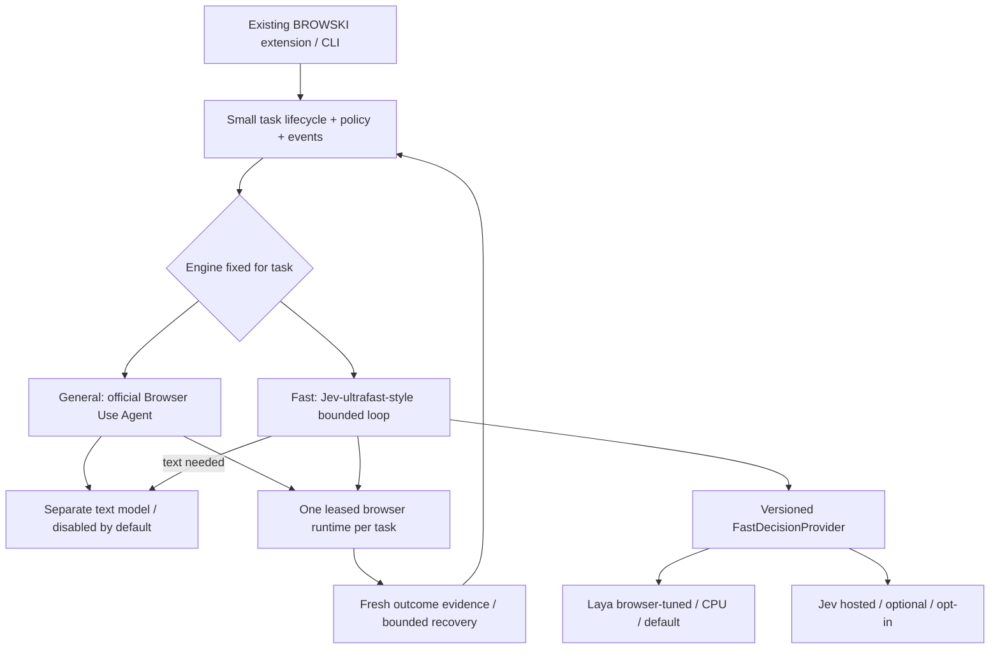

# BROWSKI architecture — TARGET / IN MIGRATION

This is the single canonical architecture plan for the production `mango`
checkout. Read `AGENTS.md`, `CODE_QUALITY.md` and
[the migration checkpoint](docs/architecture/migration-status.md) at session start.
The previous Luna plan is historical (Git parent of ADR-022), not a
second active roadmap. Detailed legacy contracts remain in `docs/architecture/`
and ADR-001–021; ADR-022 supersedes their exclusive Rust/Luna ownership rules
only for the new engines.

## Mission and evidence

Complete real browser tasks reliably, locally where viable, with outcomes that
are checked independently of model self-report. End-to-end task success is the
primary metric. Speed and low cost matter after correctness. The recorded V8
legacy study passed 16/18 development cases and 0/6 independent holdout cases
(`docs/development/long-task-diagnostics-2026-10-15.md`); it does not establish
performance of the new engines. Do not retune against that spent holdout.

## Actual implementation at migration start

- CLI: `python/src/browser_agent/cli/main.py`, `cli/config.py`.
- Python `agent/runtime.py`, `agent/graph.py`, `agent/luna.py`: LangGraph task
  lifecycle, bounded Luna decisions, memory/recovery, approval/checkpoints.
- `reasoning/openai_adapter.py`: hosted Luna reasoning. Existing Laya service
  adapter is shadow-only; existing Jev adapter is not an enabled product path.
- `session.py` → PyO3 `crates/python-bindings/` → Rust `browser-core`, `cdp`,
  `observation`, `element-registry`, `executor`, `verification`, `recovery`:
  managed Chromium or extension-attached browser mechanics.
- WXT/React `extension/`: side panel, Native Messaging, owned-tab debugger proxy.
  Python `extension/`: authenticated local service, task/events/settings bridge.
- `providers/`, `persistence/`: privacy boundary, encrypted legacy checkpoints,
  keyring credentials, local metrics/debug retention.

New General implementation: `engines/general.py` wraps the official Agent;
`engines/browser_use_runtime.py` owns its isolated profile and fresh URL/H1
evidence; `cli/engines.py` exposes an explicit paid-opt-in migration command.
A small live Wikipedia extraction passed with two authorized OpenAI calls.
The packaged extension also completed a controlled article read through the actual
Native Messaging bridge with the official Agent and bounded live OpenAI inference.
This establishes integration, not broad task reliability.
Fast navigation is implemented in `engines/fast.py` and `fast_browser.py`, using
the same Browser Use session ownership with local Laya decisions. It supports
same-site links and caller-owned URL/H1 checks; forms/text are not yet offered.
`cli/fast.py` exposes checkpoint preparation and local-default Fast execution.
Product task submission and `browski run/task` now dispatch through
`engines/product.py`, defaulting to Fast/Laya with paid inference disabled.
The extension selects General/Fast for the next task and identifies the separate
managed browser. Legacy attached execution requires explicit configuration.
`extension/engine_tasks.py` maps engine events into the bounded timeline;
`engines/lifecycle.py` owns pause boundaries and cancellation. Existing approval
UI remains available to Legacy; new navigation tools cannot submit forms. Managed
CLI/extension runs share opt-in bounded diagnostic capture and model/action/failure
traces. The final result exposes execution counters and verification. Detailed
Fast inputs can be compared with `browski compare-fast`; no browser actions are
executed by comparison, and live Jev remains unverified without credentials.

These are legacy capabilities and a narrow new engine slice, not proof that
the whole target is implemented.
See the checkpoint for the latest verified phase.

## Target responsibilities

Browser Use and jev-ultrafast are separate implementations, not interchangeable
native Agent APIs. General wraps the official open-source Agent. Fast adapts
Jev's indexed operation/target question design, with independent Laya/Jev
adapters and separately configurable text synthesis. No extra Python service
is required merely to host these engines. A local inference process may be
used if it simplifies warm model reuse.

The product layer owns task lifecycle, engine/provider configuration, policies,
approval, progress/events, cancellation, results and metrics. It must not become
another planner/framework. Preserve existing product components when they fit.
Initial engine selection lasts the entire task; safe provider switching in Fast
may follow later. No two executors may control the same session concurrently.
Extension attachment compatibility must be proved: `chrome.debugger` relay is
not automatically a Browser Use browser-level CDP WebSocket. Managed local
Chrome is the first vertical slice; do not expose unrestricted personal tabs.

## Inference and outbound policy

Target defaults: Fast + local Laya, text generation disabled, `allow_paid_api=false`.
The user clarified that this machine may run only Laya locally. Text generation
is therefore disabled, not downloaded or inferred on CPU. The user subsequently authorized small bounded OpenAI debugging and reuse of
the existing key. Use explicit paid opt-in for those smoke runs only; routine
inference and all fallbacks remain local-only/disabled. No General success is
claimed before real verification. Installation,
doctor and offline tests must not require Jev or any hosted credentials.
Hosted inference needs explicit provider selection, endpoint, credentials and
paid-API permission; no silent fallback, telemetry inference or cloud browser.
Reject accidental remote local-model endpoints unless explicitly allowed.
Codex subscription access is never runtime inference credit.

Implemented contract: `browski.fast.v2` (ADR-024), with migration for saved v1
requests. Destination context is shared across providers; complete private hrefs
also participate in freshness hashing. Contracts and adapters live in
`engines/fast_contract.py` and `engines/fast_providers.py`;
`laya_worker.py` owns one warm CPU inference process with bounded shutdown.
Jev uses the current HTTP contract, with offline fixtures only. Laya and Jev
receive equivalent state; their raw Score formats are adapted separately.

The shared Fast contract carries version, task context, current observation,
valid operations/candidates, recent history and typed questions. Results carry
normalized choices/targets/status, available probabilities, provider, inference
timing and failure/abstention. Keep SDK/raw formats inside adapters. Calibrate
providers separately. Provider selection cannot change browser execution,
state schemas or benchmark definitions; no retraining to switch providers.

Inspect released Laya checkpoint metadata and current reference code before
pinning. Use Linux/PyTorch CPU, not Apple MLX. Start from released browser-tuned
weights, not generic zero-shot weights or training. Measure cold/warm latency,
peak memory and candidate/context limits on this machine; GPU claims do not
transfer to an i5-8350U. Local models may limit complex-task success: report it.

## Verification, safety and lifecycle

Observe → decide → validate → execute → verify → continue/recover/stop.
Keep bounded time, steps, history and retries. DONE or final model text does not
prove completion. Task-specific fresh evidence must establish the requested
outcome. Unverifiable completion remains partial/blocked, never a success.
Target terminal states: `completed`, `partially_completed`, `blocked`, `failed`,
`cancelled`. Independent benchmark verifiers are outside the model policy.

Keep human approval for consequential submission, sending, purchases, deletion,
publication and account/security changes. Treat page instructions as untrusted
input. Credentials do not enter page context/traces. Default local tests use
isolated fixture pages; no real purchases, account actions or messages.
Cancellation closes task-owned resources and preserves user-owned sessions.
Browser ownership and approval guarantees must pass before extension rollout.

## Module ownership during migration

- `python/src/browser_agent/engines/` (introduced in phase 1): new engine
  adapters/lifecycle contracts and independent verification; no legacy graph
  requirement. Keep this small; split only along real responsibilities.
- `decisions/`: existing provider code is reusable after contract compatibility
  review; new Fast provider contract/version must not masquerade as legacy.
- `cli/`, Python `extension/`, TypeScript `extension/`: product integration,
  configuration and event translation, not duplicate agent intelligence.
- `crates/`, `agent/`, `reasoning/`: legacy rollback until replacements pass.
  Shared legacy schemas remain Rust-owned plus the sanctioned Pydantic mirror.
- `python/tests/`, `benchmarks/`: extend existing suites. Prefer four compact
  boundaries: provider contract, engine integration, product lifecycle, E2E.

## Phases and acceptance

0. Guidance, ADR, branch and checkpoint validated and committed.
1. Real Browser Use completes one independently verified task with its configured
   generative provider (authorized bounded OpenAI here), events, cancellation,
   cleanup and a reproducible CLI. Local generative models are disabled here.
2. Actual extension task reaches General and returns verified results with
   ownership, progress, controls and human approval preserved; legacy rollback.
3. One versioned Fast decision API, equivalent requests and parameterized
   adapter validation/error/timeout tests. No duplicate vendor policy loops.
4. Released browser-tuned Laya runs a real Fast task locally with independent
   proof; warm model reuse and measured CPU/memory limits; no paid calls.
5. Jev offline contract validation and simple provider switching; live Jev
   explicitly unverified until credentials exist. Default remains local Laya.
6. Reuse UI settings/trace controls for engine, provider, model/endpoints,
   paid opt-in and debug level. Distinguish inference/action/verification errors.
7. Improve recorded failure categories against fresh tasks without raising
   false success: candidates/fields/dates/selects/dynamic pages/tabs/transfers,
   navigation, repetition and incomplete workflows. Keep bounded recovery.
8. Measure optimization and remove legacy only after replacement regression
   gates. Maintain useful product functionality, attribution and reproducibility.

Each successful phase gets a reviewed scoped commit and checkpoint update.
Do not label an unfinished phase complete. Commit hashes are recorded in the
following checkpoint update, avoiding self-referential commit contents.

## Validation and readiness

Follow [evaluation-plan.md](docs/benchmarks/evaluation-plan.md). Record task and
false-success rates, task/fast-decision latency, generative calls, action and
recovery counts, provider errors and memory where meaningful. Keep weights,
logs, profiles and traces ignored. Unit mocks establish contract behavior only;
real application-path browser tasks establish functional evidence. Include new
unseen cases before readiness and at least one multi-step task. Keep software
checks separate from autonomous model success. Preserve necessary legacy tests.

Use the existing Rust/Python quality gates; extension changes also require
`npm run check` and packaged-Chromium tests. Report blocked/skipped checks and
hardware/model limits accurately. Never claim broad reliability from a single
integration success, or weaken outcome checks to improve scores.
