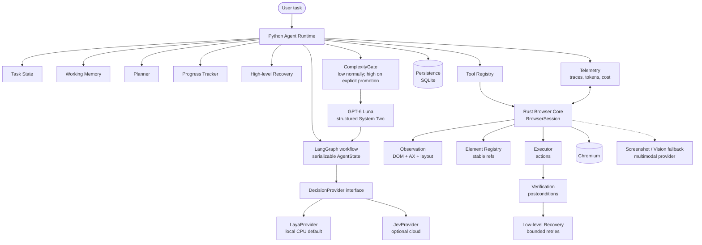

# System overview

Current BROWSKI architecture and implementation boundary. M0–M7 provide the
Rust browser runtime, semantic observation, typed action execution, Python
LangGraph orchestration, shared Laya/Jev System One adapters, structured
GPT-6 Luna escalation, durable task checkpoints, bounded working memory,
progress tracking, recovery budgets, and high-risk confirmation. Live provider
quality, calibration, and latency remain unmeasured.

## Component responsibilities

| Component | Owner | Role |
|---|---|---|
| Agent Runtime | Python | LangGraph observe/decide/execute/verify loop with bounded steps |
| Working Memory | Python | Compressed history, facts, milestones, failed strategies (bounded) |
| Planner | Python | Short milestone plans and one typed next action; Luna only on bounded escalation |
| Tool Registry | Python | Model-facing typed tools bridging into the Rust runtime |
| Provider Layer | Python | M5 provides shared Choice/Score/Noul, verification, recovery, and progress contracts; Laya is local/default, Jev optional |
| Reasoning Layer | Python | M6 uses structured GPT-6 Luna output and deterministic low/high effort routing |
| Rust Browser Core | Rust | `BrowserSession`: Chromium process, tab/frame coordination, events |
| Observation | Rust | DOM + accessibility + layout → `SemanticSnapshot` |
| Element Registry | Rust | Stable refs (`@name`), fingerprints, reacquisition, generations |
| Executor | Rust | Validated actions only — no reasoning |
| Verification | Rust | `SUCCESS / FAILURE / UNCERTAIN` + evidence for every action |
| Low-level Recovery | Rust | Stale nodes, detached frames, nav races; bounded mechanical retries |
| Vision fallback | Python+provider | Screenshots to a multimodal model when native semantics are insufficient |
| Checkpointing | Python | LangGraph thread checkpoints; `AgentRuntime.open_sqlite` uses the async SQLite saver and can resume after process exit |
| Telemetry | both | Trace events, timing, tokens, cost |

## Key invariants

- The browser core never knows which LLM provider is in use.
- Laya and Jev implement the same typed decision contract, but confidence is
  calibrated and thresholded independently per provider; raw values are not
  compared across providers.
- Browser infrastructure and reasoning stay in separate processes of
  responsibility (Rust vs Python), joined only by the versioned binding API.
- Frontend/browser-facing code talks through public APIs and events, never by
  linking agent internals.
- See `language-boundaries.md`, `verification-and-recovery.md`,
  `privacy-and-vision.md`, and `../protocols/versioning.md`.
