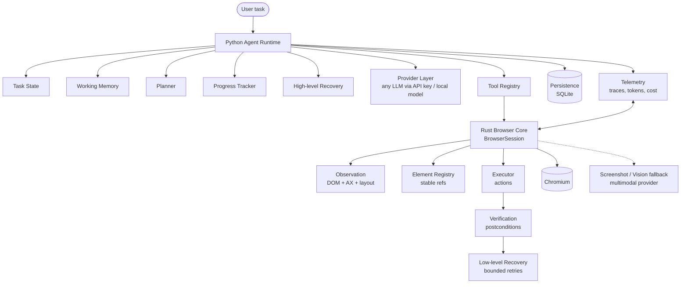

# System overview

Future-state architecture of the browser agent. The v0.1 scaffold implements
only the bottom path (Python `BrowserSession` → Rust `BrowserSession` →
Chromium, URL + title observation); everything else below is a contract or a
documented placeholder.

## Component responsibilities

| Component | Owner | Role |
|---|---|---|
| Agent Runtime | Python | UNDERSTAND→PLAN→OBSERVE→DECIDE→ACT→VERIFY→UPDATE→CHECK→RECOVER loop |
| Working Memory | Python | Compressed history, facts, milestones, failed strategies (bounded) |
| Planner | Python | Next-action decisions; hierarchical planning later |
| Tool Registry | Python | Model-facing typed tools bridging into the Rust runtime |
| Provider Layer | Python | OUR interface (`providers/base.py`); LiteLLM is one adapter |
| Rust Browser Core | Rust | `BrowserSession`: Chromium process, tab/frame coordination, events |
| Observation | Rust | DOM + accessibility + layout → `SemanticSnapshot` |
| Element Registry | Rust | Stable refs (`@name`), fingerprints, reacquisition, generations |
| Executor | Rust | Validated actions only — no reasoning |
| Verification | Rust | `SUCCESS / FAILURE / UNCERTAIN` + evidence for every action |
| Low-level Recovery | Rust | Stale nodes, detached frames, nav races; bounded mechanical retries |
| Vision fallback | Python+provider | Screenshots to a multimodal model when native semantics are insufficient |
| Persistence | Python (SQLite/aiosqlite now; Rust ownership later if justified) | Runs, checkpoints, resume |
| Telemetry | both | Trace events, timing, tokens, cost |

## Key invariants

- The browser core never knows which LLM provider is in use.
- Browser infrastructure and reasoning stay in separate processes of
  responsibility (Rust vs Python), joined only by the versioned binding API.
- Frontend/browser-facing code talks through public APIs and events, never by
  linking agent internals.
- See `language-boundaries.md`, `verification-and-recovery.md`,
  `privacy-and-vision.md`, and `../protocols/versioning.md`.
