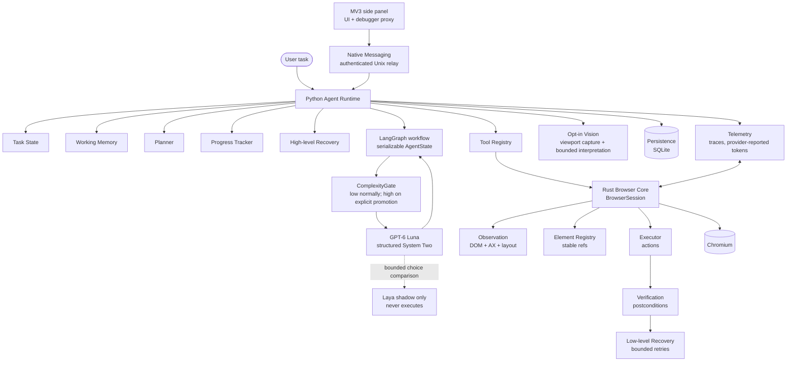

# System overview

Current BROWSKI architecture and implementation boundary. M0–M7 provide the
Rust browser runtime, semantic observation, typed action execution, Python
LangGraph orchestration, structured GPT-6 Luna decisions, durable task
checkpoints, bounded working memory, progress tracking, recovery budgets, and
high-risk confirmation. Luna is the only active action selector. Laya is
shadow-only and Jev is disabled. A local Rust action has a small-page latency
measurement; live provider quality, calibration, and latency remain unmeasured.

## Component responsibilities

| Component | Owner | Role |
|---|---|---|
| Agent Runtime | Python | LangGraph observe/decide/execute/verify loop with bounded steps |
| Working Memory | Python | Compressed history, facts, milestones, failed strategies (bounded) |
| Planner | Python | Luna produces short milestone plans and bounded executable actions |
| Tool Registry | Python | Model-facing typed tools bridging into the Rust runtime |
| Provider Layer | Python | M5 provides shared Choice/Score/Noul, verification, recovery, and progress contracts; Laya is shadow-only, Jev disabled |
| Reasoning Layer | Python | M6 uses structured GPT-6 Luna output and deterministic low/high effort routing |
| Rust Browser Core | Rust | `BrowserSession`: Chromium process, tab/frame coordination, events |
| Observation | Rust | DOM + accessibility + layout → `SemanticSnapshot` |
| Element Registry | Rust | Stable refs (`@name`), fingerprints, reacquisition, generations |
| Executor | Rust | Validated actions only — no reasoning |
| Verification | Rust | `SUCCESS / FAILURE / UNCERTAIN` + evidence for every action |
| Low-level Recovery | Rust | Stale nodes, detached frames, nav races; bounded mechanical retries |
| Vision fallback | Python+provider | Opt-in visual-task routing, bounded viewport capture and advisory interpretation; blocked in privacy-first/offline until screenshot sanitation exists |
| Checkpointing | Python | AES-GCM encrypted LangGraph SQLite checkpoints, bounded state, restart/resume and preview-first retention cleanup |
| Telemetry | both | Safe trace events, local aggregate run counters, timing, and provider-reported tokens; no external analytics |
| Browser code | Rust+Python | Opt-in isolated QuickJS transform over bounded semantic data; no live DOM, shell, filesystem, or network |
| Extension | TypeScript | Side-panel UI, permission broker and owned-tab debugger transport; no duplicate reasoning/verification |

## Key invariants

- The browser core never knows which LLM provider is in use.
- Laya and Jev implement the same low-level typed decision contract, but
  confidence is calibrated independently per provider. Current runtime policy
  permits only shadow comparison from Laya; it does not authorize actions.
- Browser infrastructure and reasoning stay in separate processes of
  responsibility (Rust vs Python), joined only by the versioned binding API.
- Frontend/browser-facing code talks through public APIs and events, never by
  linking agent internals.
- See `language-boundaries.md`, `verification-and-recovery.md`,
  `privacy-and-vision.md`, and `../protocols/versioning.md`.
